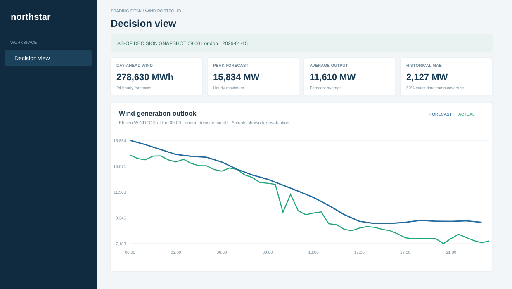

# Windwatch UK

Day-ahead wind forecast monitoring for UK power buyers, built on Elexon BMRS Insights WINDFOR forecasts and FUELHH wind actuals. The application selects the last forecast published by the decision cutoff, measures forecast error, and provides desk-friendly charts and exports.

> AI tools (OpenAI Codex / Claude) were used to assist in building this application.

## January 2026 snapshot

This repository includes a real Elexon snapshot in `backend/data/`: 1,488 FUELHH actual rows for the requested UTC range and 18,080 WINDFOR forecast-vintage rows covering January delivery times. The downloader uses the official stream parameters `settlementDateFrom`, `settlementDateTo`, `fuelType`, `publishDateTimeFrom`, and `publishDateTimeTo`; the live endpoints were queried successfully. Since FUELHH is half-hourly and observed WINDFOR rows are hourly, FUELHH observations are averaged in UTC to hourly means before `startTime` matching; at the default cutoff all 744 hourly forecasts match an hourly actual mean (100% coverage). The 1,488 half-hour observations are retained as source data, not double-counted in evaluation. See [docs/ANALYSIS.md](docs/ANALYSIS.md) for the computed findings: January wind forecasts averaged about 1.85 GW above actual output. Correlation is 0.928 while R² is 0.604, consistent with forecasts tracking the broad shape while sitting at a different level. A difference in measurement basis is one hypothesis: FUELHH WIND may exclude embedded generation, or WINDFOR may use a different basis; this dataset does not establish the cause.



## Start locally

Python 3.11+ and Node 20+ are required.

```powershell
python -m venv .venv
.\.venv\Scripts\Activate.ps1
pip install -e .\backend[dev]
python backend/scripts/fetch_data.py
uvicorn app.main:app --app-dir backend --reload --port 8000
```

In another terminal:

```powershell
cd frontend
npm install
npm run dev
```

Open http://localhost:5173; API docs are at http://localhost:8000/docs. With Docker, run `docker compose up --build` and open http://localhost:3000. The API is on :8000.

Refresh the fixed January snapshot by running `python backend/scripts/fetch_data.py`. Run backend checks using `pytest backend/tests` and `ruff check backend` and `black --check backend/app/main.py` (the CI workflow checks all Python files); frontend checks using `cd frontend && npm test && npm run build`.

## Deploy to Vercel

The Vercel build uses the static Vite artifact plus `api/index.py`; `vercel.json` bundles the 2.3 MB JSON snapshot with the Python function. The Vercel Python runtime supports FastAPI, and its current documentation allows function `includeFiles` configuration alongside rewrites.

1. Ensure `backend/data/actuals.json` and `forecasts.json` are populated and committed (or deploy from the already populated workspace).
2. Install the Vercel CLI and authenticate: `npm i -g vercel; vercel login`.
3. From repository root run `vercel --prod` and follow project linking prompts.
4. No environment variables are required. Optionally set `DECISION_CUTOFF` to an `HH:MM` Europe/London value (default `09:00`). Vercel deployment has not been run here.

## Architecture

The FastAPI service reads the committed snapshot from disk, applies the cutoff selection in UTC, joins actuals by start time, and returns typed JSON-compatible responses or CSV. The Vite React/TypeScript single-page client presents four desk views. `docker-compose.yml` runs the API plus Nginx-served static client. The Vercel config routes `/api/*` to the Python ASGI app and serves the Vite build. See [docs/ARCHITECTURE.md](docs/ARCHITECTURE.md).

## Design decisions and assumptions

- Decision cutoff defaults to 09:00 Europe/London on the preceding local calendar day. UI input may adjust it.
- Input delivery dates are restricted to 2026-01-01 through 2026-01-31. Timestamps and joins are UTC; day/cutoff interpretation and display use Europe/London.
- For each startTime, the chosen forecast is the record with greatest publishTime no later than cutoff. Missing periods are retained.
- Error is actual − forecast. NMAE is the average absolute error divided by max(actual, 1 MW), expressed as percent. R² uses actual variance; correlation is Pearson correlation. Bias-corrected MAE/RMSE subtract the evaluation sample mean signed error before scoring; these in-sample diagnostics show residual spread after removing a constant offset and are not out-of-sample performance estimates.
- FUELHH observations are half-hourly and WINDFOR is hourly; each UTC hour’s actual is the arithmetic mean of its :00 and :30 FUELHH readings, evaluated against the hourly forecast. Daily forecast energy sums hourly MW values over their one-hour periods. The UI evaluates and plots hourly data; raw half-hour actuals remain available in the snapshot for context. Decision-view uncertainty uses the nearest horizon bucket's historical signed-error P10/P90; these are empirical ranges, not guarantees.
- National wind only, Elexon only, January 2026 delivery. Demand is user-entered and never sourced externally.

## Limitations / next steps

The app has not been deployed to Vercel. Live URL: [TODO_VERCEL_URL](TODO_VERCEL_URL). Run `vercel --prod` after linking a project; the static frontend and snapshot-backed Python function are configured. Validate the January bias and empirical ranges on additional delivery months before using them as operational procurement rules. The initial frontend bundle is above Vite's 500 kB advisory threshold.

## Repository map

```text
.
├── .github/ — continuous integration configuration
│   └── workflows/ci.yml — Black, Ruff, pytest, Vitest, and production build checks
├── api/index.py — Vercel FastAPI ASGI entrypoint
├── backend/ — API service, Elexon fetcher, tests, and snapshot
│   ├── .env.example — Elexon URL and default cutoff settings
│   ├── app/ — FastAPI routes, schemas, selection, and metrics
│   │   └── __init__.py — Python package marker
│   ├── app/main.py — REST endpoints, UTC selection, and analysis calculations
│   ├── app/schemas.py — typed Pydantic response models
│   ├── data/ — cached Elexon snapshot files
│   │   ├── actuals.json — January UTC-window FUELHH wind actuals
│   │   ├── forecasts.json — WINDFOR vintages for January delivery start times
│   │   └── manifest.json — snapshot window, row counts, and download time
│   ├── pyproject.toml — pinned Python packages, pytest, Ruff, and Black configuration
│   ├── scripts/ — API ingestion scripts
│   │   └── fetch_data.py — chunked Elexon snapshot downloader with retries
│   └── tests/ — API validation, cutoff selection, and metric fixture tests
│       ├── test_api.py — health, date-range, and day-list checks
│       └── test_metrics.py — cutoff selection and metric fixture checks
├── docs/ — product, architecture, findings, and recording materials
│   ├── ANALYSIS.md — computed January findings and buyer guidance
│   ├── ARCHITECTURE.md — Mermaid diagram and module/data flow
│   ├── VIDEO_SCRIPT.md — timed customer pitch and technical tour
│   └── preview.svg — January 15 dashboard preview drawn from cached readings
├── frontend/ — Vite, React, TypeScript, and Recharts user interface
│   ├── index.html — browser entry document
│   ├── nginx.conf — static hosting and API proxy rules
│   ├── package.json — frontend commands and pinned dependency versions
│   ├── package-lock.json — exact npm dependency tree
│   ├── src/ — React screens, styling, formatting utility, and tests
│   │   ├── main.tsx — navigation, controls, charts, and tables
│   │   ├── main.test.ts — Vitest formatting tests
│   │   ├── utils.ts — shared number and missing-value formatter
│   │   └── style.css — responsive dashboard design system
│   ├── tsconfig.json — strict TypeScript compiler settings
│   └── vite.config.ts — Vite and local API proxy configuration
├── .gitignore — generated builds, caches, and secrets to exclude
├── Dockerfile.backend — FastAPI container build
├── Dockerfile.frontend — Vite build and Nginx image
├── docker-compose.yml — two-service local deployment
├── README.md — setup, deploy, assumptions, and project overview
├── requirements.txt — pinned serverless Python dependencies
└── vercel.json — static build, ASGI route, and snapshot bundle inclusion
```

